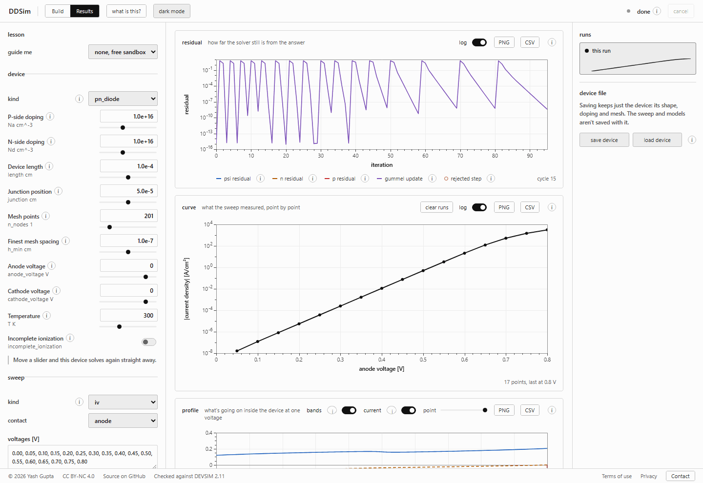
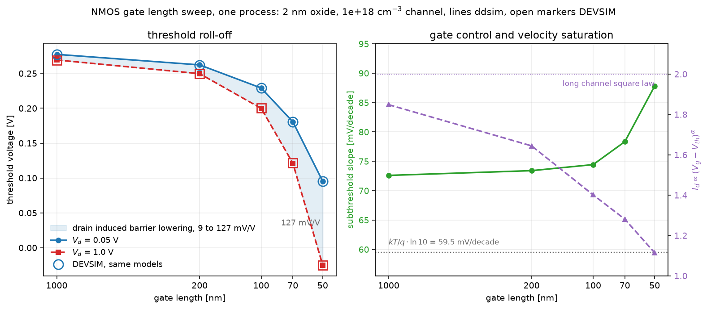
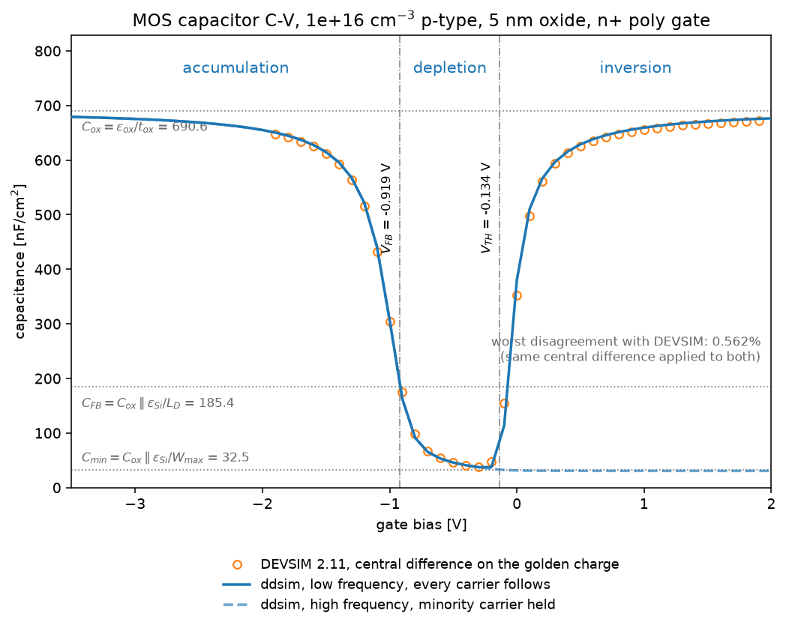
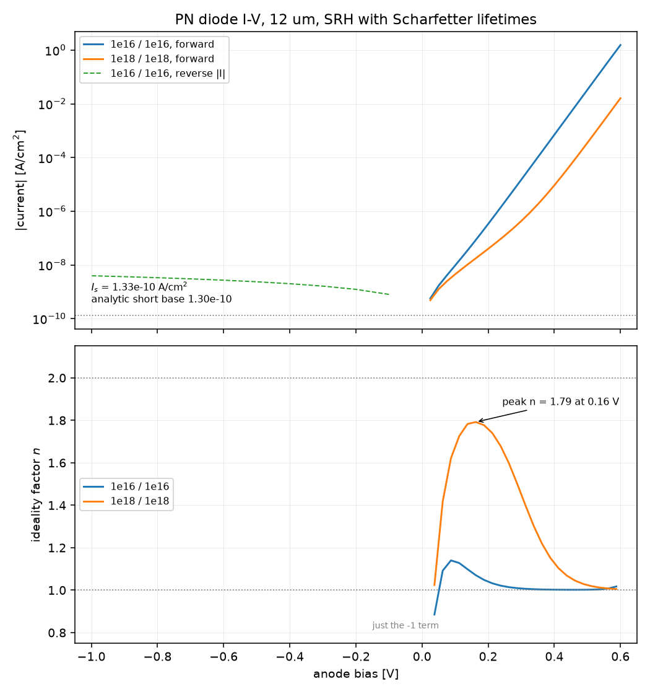

# DDSim

[](https://github.com/yaasshh09/DDSim/actions/workflows/ci.yml)

I built a working semi-conductor device simulator completely from scratch. It has been benchmarked against the famous and public DEVSIM. It solves the drift diffusion equations in order to get the corressponding IV and CV curves

<p align="center">
  
</p>

## What it does

This project is based on poisson’s equation along with electron and hole continuity equations (from the van roosbroeck system) in 1D and 2D. 

It can simulate devices such as PN diodes, MOS capacitors, NMOS transistors, and custom 2D devices.

<p align="center">
  
</p>
<p align="center">
  
</p>

<p align="center">
  
</p>

## Web app

The browser front end runs the real solver on the server and streams progress
back over a web socket, so you watch the residual fall and the curve draw point by point.


<p align="center">
  
  
</p>

You can see where the current flows and draw a cutline through the device, or
sweep a MOS capacitor's C-V.

<p align="center">
  
  
</p>

Every knob has an explainer. Each one starts with a plain
explanation, then goes into the equations and points to the docs it came from.

<p align="center">
  
</p>

You can also draw your own device out of silicon, oxide, implants and
contacts, then solve it as you wish.

<p align="center">
  
</p>

## Numerical Stability & Local Development Boundaries

Drift diffusion is stiff. Carrier density goes as exp(psi / V_T), so a 26 mV
mistake in potential is a factor of e in current. These are the limits I run
the solver inside, and what I change when I push past them on my own machine.

**When I call it converged.** Newton stops when the residual drops below
1e-10 relative (1e-12 absolute) and the update drops below 1e-10. Equilibrium
gets 50 iterations and each bias solve gets 30. I don't loosen these to make a
hard case pass. A solve that only converges at 1e-6 is usually a sign error or
a bad mesh, and `docs/05-pitfalls.md` lists what to check first.

**How the bias ramp works.** I never jump a contact straight to its target.
`solve_bias_ramped` solves at zero bias, then scales every contact voltage
together from 0 to 1 of its target. The first step goes a quarter of the way.
Each step that converges makes the next one 1.5x bigger, and each one that
fails gets cut in half and tried again. If the step falls below a thousandth
of where it started, or the ramp burns 200 attempts, it stops and says so
instead of handing back a bad answer. Inside each Newton step the potential
update is capped at 5 thermal voltages (about 0.13 V), which keeps the
exponentials from overshooting on the first few iterations.

**Where the mesh needs care.** Neighbouring cells can grow by at most 1.5x,
and the graded meshes refuse anything steeper. The fine spacing sits where the
physics changes fastest: 1e-7 cm at a diode junction, and 6.25e-9 cm at the
MOSFET silicon surface, where the inversion layer is a few nm thick. The trap
is the Si/SiO2 seam. Silicon and oxide are meshed separately and joined, so
the 1.5x guard never sees the seam. If you halve `h_min_y` without also
raising `n_oxide`, the jump across the interface doubles and nothing warns
you.

**Floating point.** Exponentials are clamped at exp(700), just under where
float64 overflows. The Bernoulli function switches to its series below
|x| = 1e-4, where the closed form loses digits to cancellation. In a MOSFET's
off state the drain current is a small difference of much bigger fluxes, so a
finer mesh can actually be noisier there. Compare source and drain current
before you trust a refinement.

**Changing things locally.** Every default lives in one frozen `CONFIG`
(`ddsim/core/config.py`). Don't edit it to try something out. Every solver and
device builder takes the same knobs as keyword arguments:

```python
from ddsim.device.mosfet import nmos
from ddsim.device.transport import solve_bias_ramped

dev = nmos(h_min_y=3.125e-9, n_oxide=65)
state = solve_bias_ramped(dev, step=0.05)
```

A smaller `step` costs time but gets through steep turn-on regions. When you
refine the mesh, refine both sides of an interface together, then check that
current is conserved with `./run.sh test tests/invariant`.

## License

CC BY-NC 4.0. You're free to use, share and adapt it for non-commercial work as
long as you credit me. See [LICENSE](LICENSE).
