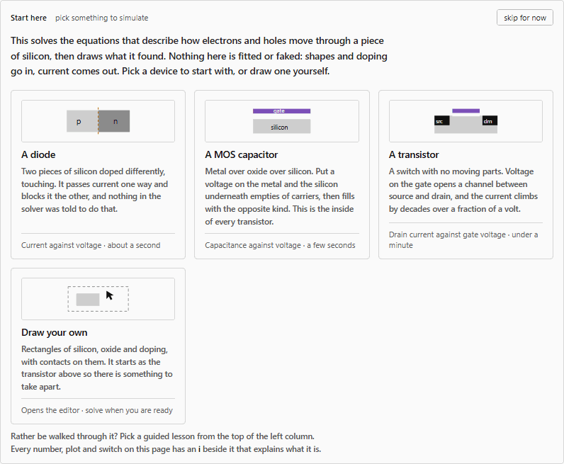
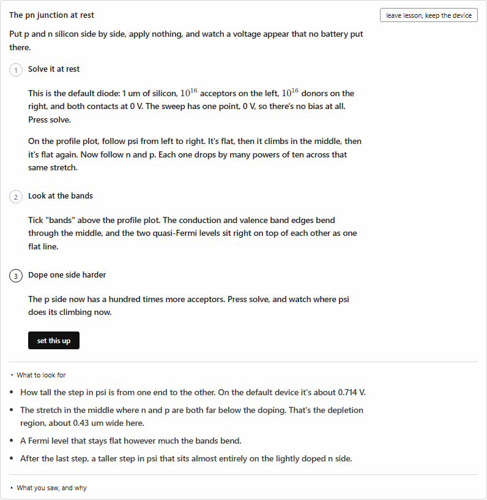
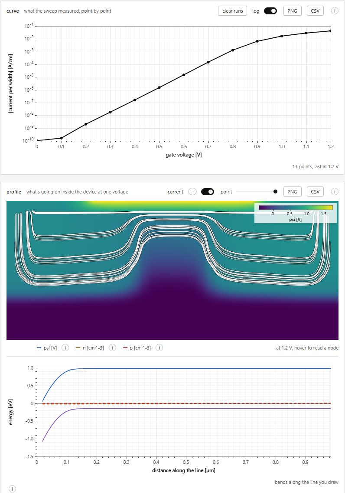
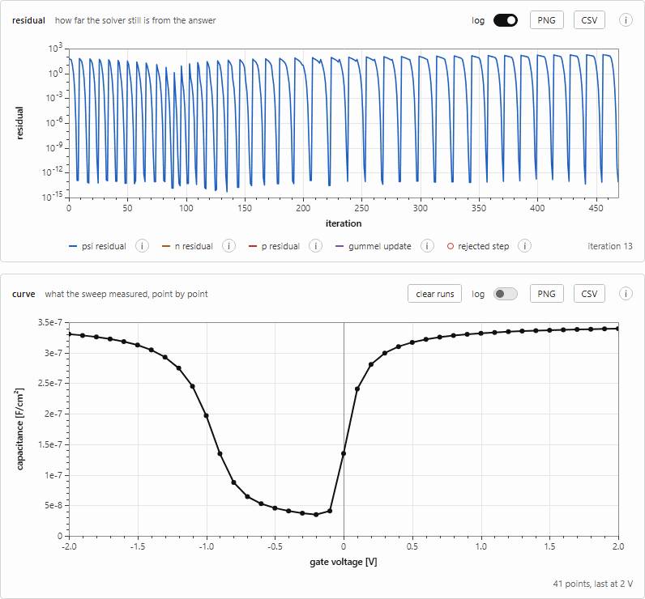
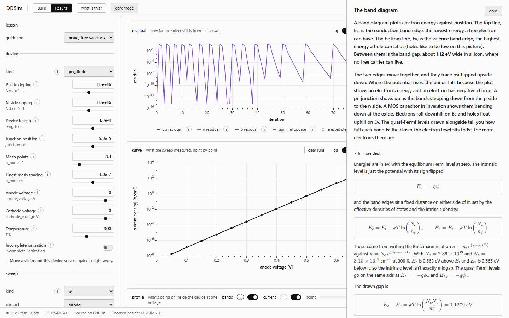
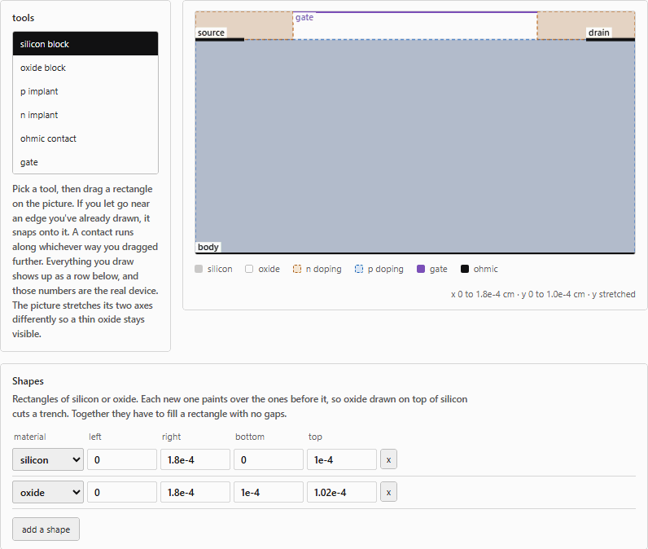

## DDSim

I built a working semiconductor device simulator completely from scratch. It has been benchmarked against DEVSIM, a public simulator. It solves the drift diffusion equations in order to get the coressponding IV and CV curves.

Built mainly using python and trace amounts of JS, CSS and HTML.

## What it does

The project is mainly based on poisson's equations along with a few electron and hole continuty equations from the van roosbroeck systems.

It can simulate a variety of devices like pn diodes, mos capacitors, nmos transistors and also has an option to create your own custom 2d devices

  

  
  

  

## Web app

The browser front end runs the solver on the server and streams progress back over a web socket. This allows us to be able to watch the residual fall and the curve draw point by point in real-time.

  
  

You can see where current flows and draw cutlines through the device, or sweep a mos capacitor's cv.

  
  

Almost everything has an in-depth explainer. Each one starts+ with a simple explanation, then goes into the equations and points to the docs it came from (WIP).

  

You can also draw your own device out of silicon, oxide, implants and contacts, then solve it as you wish. NOTE: THE FEATURE IS VERY CLUNKY, DO NOT RECOMMEND TO USE

  

## License

CC BY-NC 4.0. You're free to use, share and adapt it for non-commercial work as long as you credit me. See [LICENSE](LICENSE).
