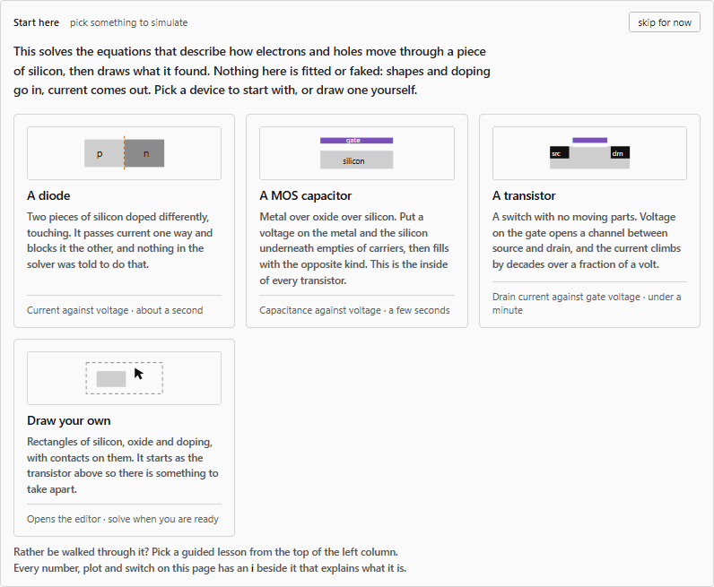
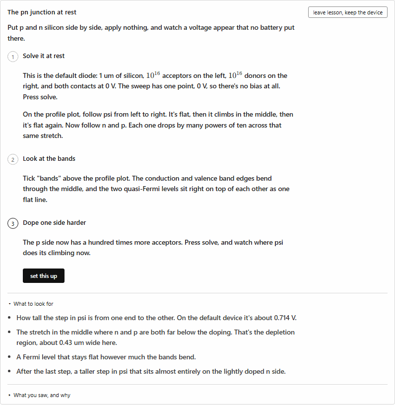
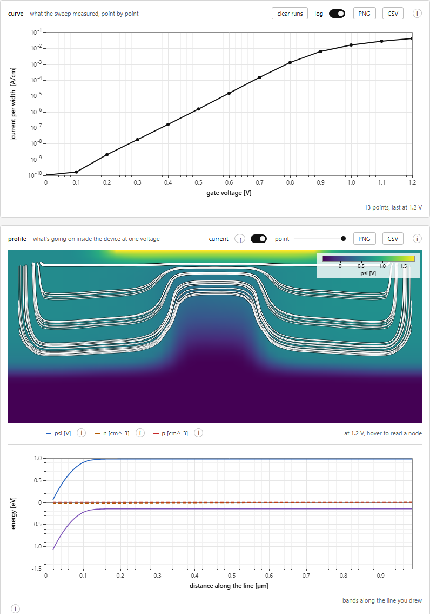
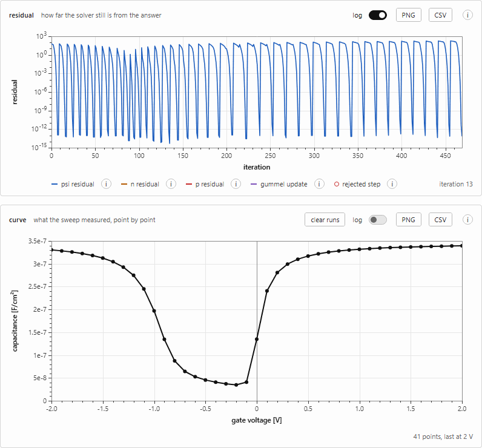
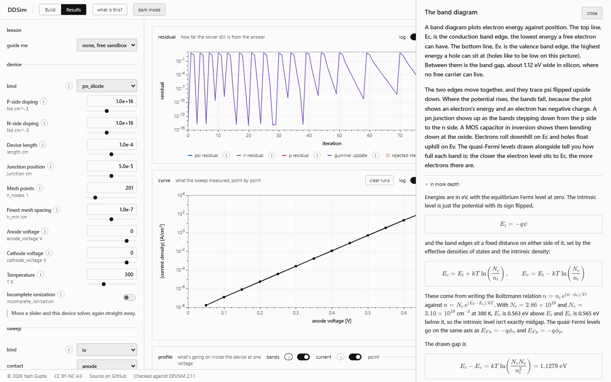
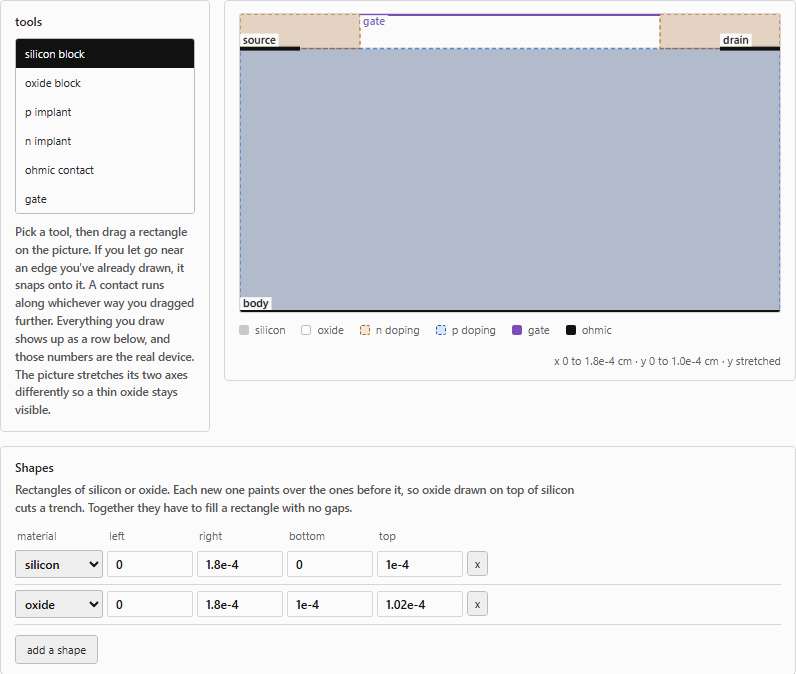

## DDSim

[](https://github.com/yaasshh09/DDSim/actions/workflows/ci.yml)

I built a working semiconductor device simulator from scratch and benchmarked it against DEVSIM, a public simulator. It solves the drift diffusion equations to get a device's IV and CV curves.

Built mainly using python and trace amounts of JS, CSS and HTML.

## What it does

The project is mainly based on Poisson's equation along with the electron and hole continuity equations, which together make up the Van Roosbroeck system.

It can simulate a variety of devices like pn diodes, mos capacitors, nmos transistors and also has an option to create your own custom 2d devices

<p align="center">
  
</p>


<p align="center">
  
  
</p>


<p align="center">
  
</p>

## Web app

The browser front end runs the solver on the server and streams progress back over a web socket. You can watch the residual fall and the curve draw point by point in real time.


<p align="center">
  
  
</p>

You can see where current flows and draw cutlines through the device, or sweep a mos capacitor's cv.

<p align="center">
  
  
</p>

Almost everything has an in-depth explainer. Each one starts with a simple explanation, then goes into the equations and points to the docs it came from (WIP).


<p align="center">
  
</p>

You can also draw your own device out of silicon, oxide, implants and contacts, then solve it as you wish. NOTE: THE FEATURE IS VERY CLUNKY, DO NOT RECOMMEND TO USE

<p align="center">
  
</p>


## The stack

DDSim is one layer of a bigger plan. Layer 0 is [AtomSIM](https://github.com/yaasshh09/AtomSim), my Schrodinger solver for isolated atoms, and the idea is that every number DDSim uses should eventually come from a layer below it. The first real link is quantum confinement in a thin oxide MOS capacitor: AtomSIM's eigen solver finds the electron levels in the well at the interface, and DDSim uses them for the charge.

```python
from ddsim.device.mos_cap import mos_cap
from ddsim.device.schrodinger_poisson import solve_schrodinger_poisson

d = mos_cap(gate_voltage=1.5, t_ox=2e-7, substrate_doping=-1e17, h_min=1e-8, n_silicon=161)
q = solve_schrodinger_poisson(d)               # levels from atomsim.numerics.radial_solver
c = solve_schrodinger_poisson(d, quantum=False)
print(q.centroid * 1e7, c.centroid * 1e7)       # 1.62 nm against 0.47 nm
```

That needs AtomSIM installed next to DDSim (`pip install -e ../atom_sim`).

## License

BSD 3-Clause. You're free to use, change and share it, commercially too, as long as you keep my copyright notice. See [LICENSE](LICENSE).
